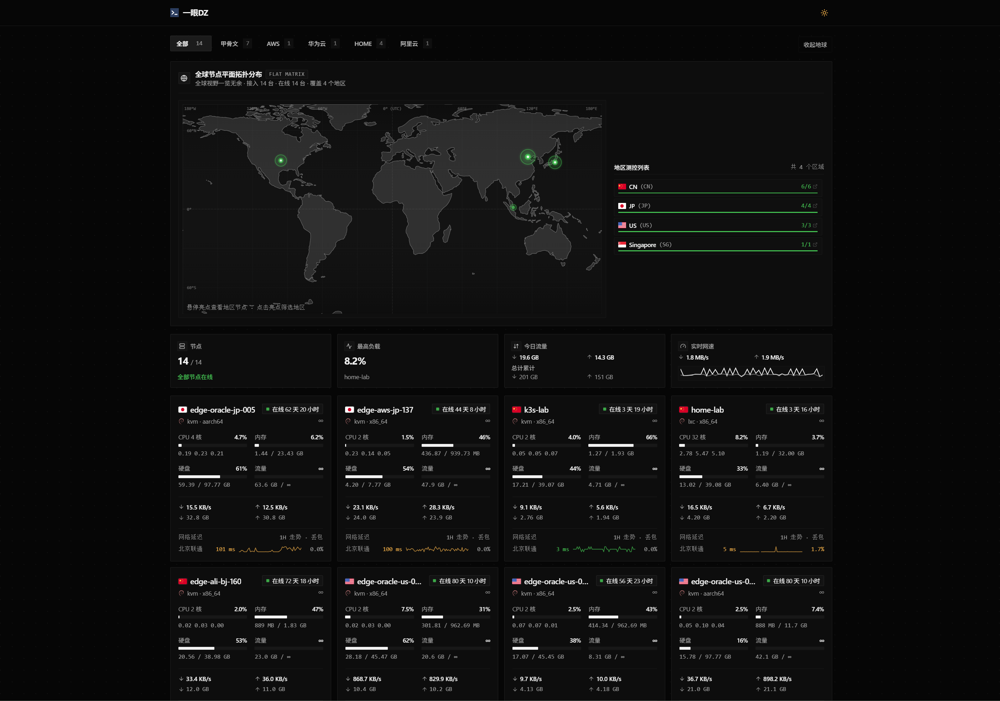

# Minidash 默认工业微倒角工控主题

本项目是 [Minidash](https://github.com/XideaDev/MiniDash) 的内置默认公开监控主题。在延续轻量、高性能、纯静态 SPA 与黑白极简纯粹质感的同时，采用**精密微倒角工业仪器风**，并针对多节点展示、深度资源遥测与网络质量洞察进行了多项功能增强。



---

## 🌟 核心特性

### 1. 全球节点分布地图（动态聚合与交互）
- **多节点地区智能聚合**：同一国家/地区合并为单个独立光点展示，光点亮度随该区域活跃节点数量自适应动态增强，避免节点重叠。
- **悬浮节点状态卡片**：鼠标悬停在光点上即弹出高层级微倒角卡片，实时列出该区域所有节点的物理主机名与绿色在线呼吸指示灯。
- **视口防遮挡渲染**：解除外部地图容器的剪裁限制，优化弹窗 z-index 层级，确保边缘地区节点弹窗不被相邻面板遮挡。

### 2. 首页网络延迟卡片与后台可配置项
- **实时延迟数据卡片**：节点卡片中支持直接展示关键探测目标的网络延迟（Ping/TCP Ping）数据。
- **后台灵活配置（`ping_lines`）**：支持在管理后台直接配置首页卡片展示的探测条目，满足不同站长对主干网络监控的定制诉求。
- **离线节点排版策略（`offline_placement`）**：后台新增离线节点排版控制，支持三种视图呈现（默认显示、全部置后、分区分隔显示）。

### 3. 节点监控详情页深度重构
- **工控规格与实时遥测矩阵**：
  - 硬件规格（CPU 架构/型号、内核版本、公网/内网标识）与运行状态。
  - 在线时长、系统负载（1/5/15m）与网络实时吞吐（上下行带宽及实时速率），采用状态胶囊与工业仪器级微倒角排版。
- **多维资源占比与热力图分析**：
  - CPU、内存、交换分区（Swap）与磁盘挂载的多维使用占比图与环形分布饼图。
  - 时段负荷活动热力矩阵（Activity Heatmap），直观洞察系统在 24 小时各时间段的高峰活跃周期与资源使用习惯。
- **网络延迟驾驶舱**：
  - 全维度延迟与网络质量分析看板（RTT 均值、峰值、抖动 Jitter 及丢包率 Packet Loss）。
  - 深浅色模式时间跨度选择器（1小时 / 24小时 / 7天 / 30天）。

---

## 💻 本地开发

```bash
# 安装依赖
npm install

# 启动开发服务器（代理到本地 Minidash Hub 服务）
MONITOR_HUB=http://127.0.0.1:9911 npm run dev

# 构建生产产物
npm run build
```
